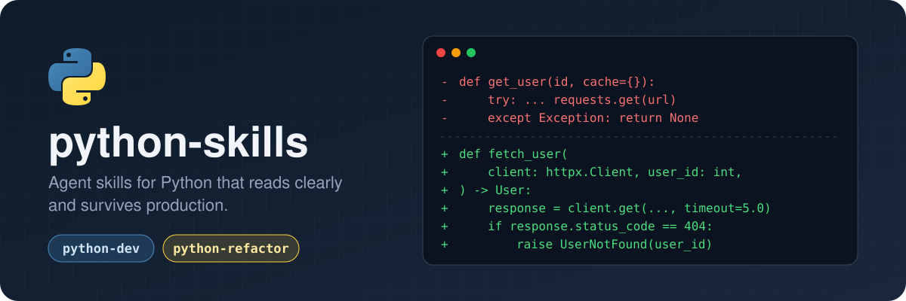

<p align="center">
  
</p>

# python-skills

Two agent skills that make coding agents write Python a senior reviewer would approve:

- **python-dev**: writing, reviewing, and setting up Python. Typed contracts, understandable execution, usable APIs, deliberate extension points, reliable operation.
- **python-refactor**: behavior-preserving cleanup. Scoped audit, characterization tests, then small verified steps toward the python-dev patterns.

They are plain `SKILL.md` folders, so they work in Claude Code, Pi, Codex, Cursor, Gemini CLI, OpenCode, and any other agent that reads skills.

## Why these skills

Coding agents write Python that runs but fails a careful code review. Typical mistakes: a broad `except` that returns `None`, a request with no timeout, an untyped dict passed through five functions, an `if/elif` chain that has to be edited for every new format, a test that was loosened until it passed. These skills address those mistakes directly:

- **Rules a reviewer can check.** Every rule names a concrete check: parse untrusted input once at the boundary, bound every wait and retry, catch exceptions only where recovery happens, never loosen an assertion to make a test pass.
- **An extension check, not blanket abstraction.** Before building a component, the agent names the next likely variant and where it would go. It adds a seam only when the variants are real. Otherwise it writes direct code plus a `shortcut:` note saying where the seam belongs.
- **Low context cost.** The core is about 1,700 words. Eight topic references (async, FastAPI, external I/O, security, pipelines, observability, patterns, project setup) load only when a task touches that topic.
- **Verification is part of the work.** The agent runs the repo's formatter, linter, type checker, and tests. It reports what failed or did not run, and checks that a library API exists in the installed version before using it.
- **Refactors that preserve behavior.** `python-refactor` pins current behavior with characterization tests, keeps structural changes separate from bug fixes, and runs the checks after each step.

## Before and after

### 1. Fetching remote data

**Before.** A typical agent's first draft:

```python
import datetime
import requests

def get_user(id, cache={}):
    try:
        if id in cache:
            return cache[id]
        r = requests.get(f"https://api.example.com/users/{id}")
        data = r.json()
        data["fetched"] = datetime.datetime.now()
        cache[id] = data
        return data
    except Exception:
        return None
```

Problems: a mutable default argument used as an unbounded, process-wide cache. No timeout. HTTP errors are not checked. Every failure (404, network error, bad JSON, even a bug) turns into `None`. The datetime has no timezone. Callers get an untyped `dict`.

**After, with python-dev:**

```python
from datetime import UTC, datetime

import httpx
from pydantic import BaseModel, ConfigDict


class User(BaseModel):
    model_config = ConfigDict(frozen=True, extra="ignore")

    id: int
    email: str
    name: str
    fetched_at: datetime


class UserNotFound(LookupError):
    pass


def fetch_user(client: httpx.Client, user_id: int) -> User:
    response = client.get(f"/users/{user_id}", timeout=5.0)
    if response.status_code == 404:
        raise UserNotFound(user_id)
    response.raise_for_status()
    return User.model_validate({**response.json(), "fetched_at": datetime.now(UTC)})
```

The rules applied:
- *Parse, don't validate.* The response becomes a typed, frozen `User` once, at the boundary.
- *Bound every wait.* Each request has a timeout.
- *Return typed outcomes; use specific exceptions.* "Not found" is its own exception, and other failures propagate instead of turning into `None`.
- *Aware datetimes for instants.*
- *Explicit resource owners.* The caller creates and owns the `httpx.Client` (base URL, connection pool). Any caching becomes an explicit, bounded decision instead of a hidden default argument.

### 2. Adding a variant without editing old code

**Before:**

```python
import csv, json

def export(rows, fmt, path):
    if fmt == "csv":
        f = open(path, "w")
        w = csv.writer(f)
        for r in rows:
            w.writerow(r.values())
        f.close()
    elif fmt == "json":
        f = open(path, "w")
        json.dump(rows, f)
        f.close()
    else:
        print("unknown format")
```

Problems: the file stays open if writing raises. The CSV has no header and depends on dict key order. Encoding is implicit. An unknown format prints a message and still "succeeds". Each new format means editing this function.

**After, with python-dev's extension check** (the next variant, Parquet, is already on the roadmap):

```python
import csv
import json
from abc import ABC, abstractmethod
from collections.abc import Mapping, Sequence
from pathlib import Path
from typing import Any, TextIO

type Row = Mapping[str, Any]


class Exporter(ABC):
    @abstractmethod
    def write(self, rows: Sequence[Row], out: TextIO) -> None: ...


class CsvExporter(Exporter):
    def write(self, rows: Sequence[Row], out: TextIO) -> None:
        if not rows:
            return
        writer = csv.DictWriter(out, fieldnames=list(rows[0]))
        writer.writeheader()
        writer.writerows(rows)


class JsonExporter(Exporter):
    def write(self, rows: Sequence[Row], out: TextIO) -> None:
        json.dump([dict(row) for row in rows], out)


EXPORTERS: dict[str, Exporter] = {"csv": CsvExporter(), "json": JsonExporter()}


def export(rows: Sequence[Row], *, fmt: str, path: Path) -> None:
    try:
        exporter = EXPORTERS[fmt]
    except KeyError:
        raise ValueError(f"unknown format {fmt!r}; expected one of {sorted(EXPORTERS)}") from None
    with path.open("w", encoding="utf-8", newline="") as out:
        exporter.write(rows, out)
```

The rules applied:
- *ABC strategy with explicit composition.* A new format is one class plus one line in `EXPORTERS`. No other code changes.
- *Context-managed cleanup* and an *explicit encoding*.
- *Actionable errors.* An unknown format raises and lists the valid ones.
- *Keyword-only arguments* for the parameters callers could confuse.

If Parquet were not actually planned, python-dev keeps the direct `if/elif` version and fixes only the bugs. That is the extension check doing its job.

### 3. Refactoring safely

Given "clean up `billing.py`", **python-refactor** does not rewrite the file in one pass. It:

1. Reports findings ranked by impact, each with path, evidence, consequence, and the check that will prove the fix.
2. Pins current behavior with characterization tests before moving any code.
3. Makes small steps, keeping structural changes separate from bug fixes. A bug it discovers gets its own labeled step with a regression test.
4. Runs the tests, linter, and type checker after every step, and never edits an expected value just to accept a regression.

## Install

**Any agent** (Claude Code, Codex, Cursor, Gemini CLI, OpenCode, Pi, and others), using the [skills CLI](https://github.com/vercel-labs/skills):

```sh
npx skills add 1y33/python-skills
```

**Claude Code**, as a plugin:

```sh
claude plugin marketplace add 1y33/python-skills
claude plugin install python-skills@python-skills
```

**Pi**, as a package:

```sh
pi install git:github.com/1y33/python-skills
```

**Manual:** copy or symlink `skills/python-dev` and `skills/python-refactor` into your agent's skills directory, for example `~/.claude/skills/`, `~/.pi/agent/skills/`, `~/.codex/skills/`, or `~/.agents/skills/`.

Agents load the skills automatically from their descriptions. You can also invoke one by name, for example `/python-dev` (Claude Code plugin: `/python-skills:python-dev`; Pi: `/skill:python-dev`).

## Test

```sh
bash tests/skills.sh
```

## License

MIT
